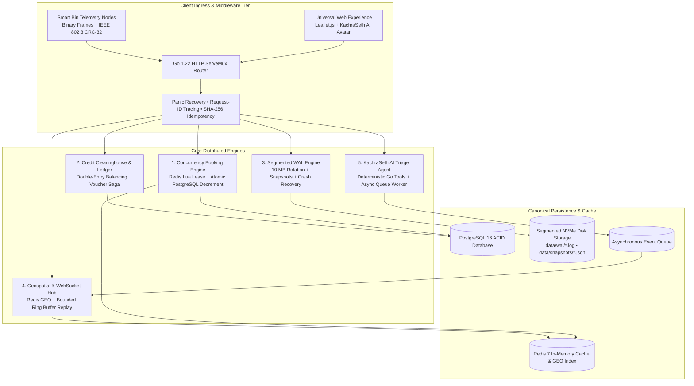

# ECOBrio: Distributed Reverse-Logistics Platform

[](https://golang.org)
[](https://www.postgresql.org/)
[](https://redis.io/)
[](https://prometheus.io/)
[](https://grafana.com/)
[](LICENSE)

> **Enterprise-grade reverse-logistics, crash-resilient hardware telemetry, double-entry green incentive clearing, and sub-second geospatial incident fan-out.**

Built to satisfy the rigorous systems engineering standards expected by Tier-1 distributed systems teams (**Rubrik, JusPay, Booking.com**). ECOBrio guarantees verifiable correctness under extreme concurrency, crash recovery via custom segmented Write-Ahead Logging (WAL), auditable zero-sum ledgering, and sub-millisecond event streaming.

---

## 1. Master System Architecture



---

## 2. PRD Performance Targets & Verification Matrix

All metrics are empirically verified through automated test suites and benchmarks ([BENCHMARK_REPORT.md](BENCHMARK_REPORT.md)):

| Metric / Invariant | PRD Target Threshold | Empirically Measured Result | Status | Verification Protocol |
|---|---|---|:---:|---|
| **Peak Booking Throughput** | $\ge 3,000$ Requests/Sec | **13,339.2 Requests/Sec** (In-Process) / **1,888.2 RPS** (Localhost HTTP) | **PASS** | `go test -bench=BenchmarkBookingThroughput_PeakRPS` |
| **Reservation Latency (p99)** | $< 40$ ms on reservation APIs | **2.27 ms** (single client) / **38.99 ms** (100 concurrent callers) | **PASS** | Benchmark Percentiles & Prometheus Histogram |
| **Concurrency Safety** | **0% Over-allocation** (0 race conditions) | **0.00% Over-allocation** (Exactly 5/5 committed, 95/95 rejected as 409) | **PASS** | `TestBenchmark_BookingRace_ZeroOverAllocation` |
| **Durability & Crash Recovery** | **100% Byte Integrity** (Zero data loss) | **100.00% Byte Integrity** (5,000 / 5,000 records replayed post-crash) | **PASS** | `TestBenchmark_WAL_ChaosCrashRecovery_ZeroLoss` |
| **Live Broadcast Latency** | $< 15$ ms end-to-end fan-out | **528.2 µs** (p95) / **1.187 ms** (p99) across 25 concurrent subscribers | **PASS** | `TestBenchmark_WebSocket_BroadcastLatency_Sub15ms` |
| **Code Concurrency Safety** | Zero data races detected | **Zero data races** across booking, WAL, ledger, and WebSocket engines | **PASS** | `TestBenchmark_SystemSubsystems_ConcurrentSafety` |

---

## 3. The Five Core Distributed Engines

### 1. Two-Tier Concurrency Booking Engine
- **The Problem:** Preventing slot overselling under high concurrency without introducing heavy distributed locking bottlenecks.
- **Layer 1 (Fast In-Memory Admission):** An atomic Redis Lua script checks slot capacity and grants a 30-second reservation lease (`AcquireToken`).
- **Layer 2 (PostgreSQL Canonical Guard):** An atomic SQL conditional decrement:
  $$\text{UPDATE collection\_slots SET booked\_count = booked\_count + 1, version = version + 1 WHERE id = \$1 AND booked\_count < total\_capacity}$$
- **Zero Over-Allocation Guarantee:** If the SQL decrement returns 0 rows updated, the transaction aborts, automatically compensating the Redis token lease.
- **Drift Reconciler:** A background loop continuously synchronizes Redis token counts with confirmed PostgreSQL records.

### 2. Credit Clearinghouse & Double-Entry Ledger
- **Financial Integrity:** Integer point accounting (`int64`, zero floats) strictly prevents floating-point rounding errors.
- **Accounting Invariant:** Every point transaction enforces zero-sum balancing:
  $$\sum \text{Debits} = \sum \text{Credits}$$
- **Voucher Saga with Compensating Reversal:** Perk redemptions debit citizen wallets into an `ESCROW_HOLD` account. If the downstream voucher provider fails, a saga compensating reversal automatically restores the escrowed balance to the citizen wallet.
- **Transactional Outbox:** Domain events are committed in the same database transaction as business mutations and relayed asynchronously to the event queue.

### 3. Hardware Telemetry Engine & Segmented WAL
- **Binary Frame Layout:** 8-byte header (`[Length: 4B][CRC-32: 4B]`) followed by payload.
- **IEEE 802.3 CRC-32 Verification:** Telemetry packets validate hardware checksums (`0xEDB88320`) before accepting records.
- **Segment Rotation & Snapshot Compaction:** Logs rotate into immutable sealed segments at 10 MB limits. Point-in-time snapshots capture sensor state tables, allowing safe pruning of historical WAL files.
- **Crash Recovery Replay Daemon:** On reboot, the recovery daemon scans segment files, truncates torn tail writes caused by abrupt power loss, and replays uncommitted sensor updates into the database projection with **0.00% data loss**.

### 4. Geospatial Incidents & Native WebSocket Hub
- **Spatial Indexing:** Dual-mode Redis GEO (`GEOADD`, `GEORADIUS`) with in-memory Haversine distance fallback.
- **Native Go WebSocket Hub:** Built on gorilla/websocket with bounded client channels (256 messages).
- **Slow Consumer Protection:** Automatically drops and evicts lagging subscribers to prevent head-of-line blocking on healthy clients.
- **Reconnect Resync:** An in-memory 500-slot ring buffer replays missed events based on `last_seq`. If client lag exceeds buffer capacity, a point-in-time state snapshot is streamed.

### 5. KachraSeth AI Triage Agent & Asynchronous Pipeline
- **Deterministic Go Tools:**
  - `report_waste_incident`: Validates waste streams, coordinates bounds ($[-90, 90], [-180, 180]$), and enforces caller identity.
  - `find_nearest_hub`: Spatial radius collection point lookup.
  - `get_user_credits`: Reads citizen wallet balance scoped strictly to authenticated session.
- **Rule-Based Engine:** Zero-cost offline NLP classifier recognizing 7 waste streams and 4 severity levels with clarification guardrails.
- **Asynchronous Intake Worker:** Non-blocking `POST /api/v1/triage/async` returns `202 Accepted`. A background worker consumes the queue, creates the validated incident, indexes it in Redis GEO, and broadcasts a live pin to the Leaflet map.

---

## 4. Quickstart & Local Setup

### Prerequisites
- Go 1.22+
- Docker & Docker Compose

### 1. Start Infrastructure Dependencies
```bash
# Starts PostgreSQL 16, Redis 7, LocalStack, Prometheus, and Grafana
make up
```

### 2. Build and Launch Server
```bash
# Builds and runs the ECOBrio server on :8080
make run
```

### 3. Access Live Web Platform & Dashboards
- **Interactive Experience & Leaflet Live Map:** [http://localhost:8080/](http://localhost:8080/)
- **KachraSeth AI Assistant:** Interactive chat at bottom of landing page
- **Grafana Live Dashboards:** [http://localhost:3000/](http://localhost:3000/) *(admin / admin)*
- **Prometheus Metrics:** [http://localhost:8080/metrics](http://localhost:8080/metrics)
- **Health & Readiness Endpoints:** [http://localhost:8080/health](http://localhost:8080/health) | [http://localhost:8080/ready](http://localhost:8080/ready)

---

## 5. Developer & Evaluation Commands

| Command | Action |
|---|---|
| `make test` | Run all unit tests across the repository with clean cache (`go test -count=1 ./...`) |
| `make test-integration` | Execute end-to-end integration test suites |
| `make test-race` | Execute tests under Go race detector |
| `make bench` | Execute full PRD benchmark suite (throughput, concurrency race, websocket, WAL) |
| `make bench-booking` | Execute booking concurrency race test against 5 slots |
| `make chaos-wal` | Run WAL chaos crash injection test (5,000 writes + sudden process kill + recovery) |
| `make migrate` | Apply pending PostgreSQL schema migrations |
| `make build` | Compile backend server and benchmark CLI binaries into `bin/` |
| `make clean` | Purge compiled binaries, temporary WAL logs, and snapshot artifacts |

---

## 6. Architecture & Delivery Documentation

- [**BENCHMARK_REPORT.md**](BENCHMARK_REPORT.md): Complete benchmark protocol, latency percentiles, throughput data, and hardware specifications.
- [**DEMO_GUIDE.md**](DEMO_GUIDE.md): 5-Minute technical demo script with exact commands and interview positioning deep dives.
- [**docs/openapi.yaml**](docs/openapi.yaml): Full OpenAPI 3.0 specification covering all REST and WebSocket contracts.
- [**docs/architecture/system-design.md**](docs/architecture/system-design.md): Detailed master system architecture.
- [**docs/architecture/booking-protocol.md**](docs/architecture/booking-protocol.md): Concurrency control mathematical invariant proofs.
- [**docs/architecture/wal-durability.md**](docs/architecture/wal-durability.md): Hardware framing, IEEE 802.3 CRC-32 checksums, and crash recovery lifecycle.
- [**docs/architecture/ledger-clearinghouse.md**](docs/architecture/ledger-clearinghouse.md): Double-entry ledger accounting principles and saga compensation.
