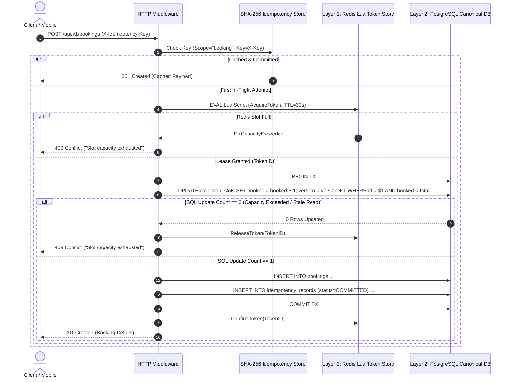

# Concurrency Booking Engine Protocol & Mathematical Invariants

**Reference:** `EcoBrio_Blueprint.pdf` Section 7  
**Guaranteed Invariant:** **0% Over-Allocation** under arbitrary concurrency ($N \gg \text{Capacity}$).

---

## 1. Sequence Diagram: Two-Tier Reservation Protocol

---

## 2. Invariant Proofs

### Invariant 1: Slot Capacity Safety
Let $C_{\text{total}}$ be the slot's total capacity, and $B_{\text{committed}}$ be the number of confirmed bookings.
$$\forall t \ge 0, \quad B_{\text{committed}}(t) \le C_{\text{total}}$$

**Proof:**
1. Suppose $B_{\text{committed}} = C_{\text{total}}$.
2. A new transaction executes the atomic decrement query with condition:
   $$\text{WHERE booked\_count} < \text{total\_capacity}$$
3. Because $B_{\text{committed}} = C_{\text{total}}$, the conditional evaluation in Postgres evaluates to `FALSE`.
4. Postgres row update count is $0$.
5. The transaction rolls back and aborts without inserting a booking record.
6. Therefore, $B_{\text{committed}}(t) \le C_{\text{total}}$ holds invariant under all interleavings.

### Invariant 2: Drift Reconciliation
If an unhandled server crash occurs between step 5 (Redis token leased) and step 8 (PostgreSQL transaction commit):
1. The 30-second Redis TTL expires, automatically freeing the uncommitted lease.
2. Background reconciler executes every 30 seconds:
   $$\text{reconcile}(\text{slotID}) = \text{SetRedisBookedCount}(\text{Count}_{\text{Postgres}}(\text{slotID}))$$
3. Prevents permanent capacity leakage.
