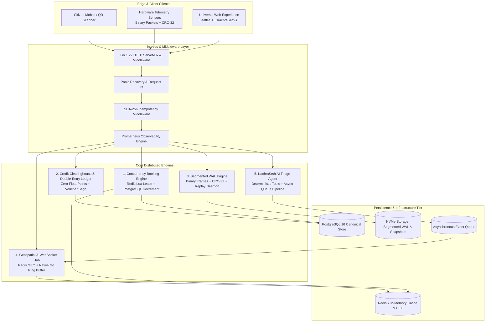

# ECOBrio Master System Architecture & Engine Design

**Reference:** `EcoBrio_Blueprint.pdf` Section 4 & 5  
**Core Invariant:** Verifiable correctness under extreme concurrency, crash recovery, and distributed failure.

---

## 1. High-Level System Architecture

---

## 2. The Four Core Distributed Engines

### Engine 1: Two-Tier Concurrency Booking Engine
- **Target:** $\ge 3,000$ RPS peak throughput with **0% over-allocation**.
- **Tier 1 (In-Memory Admission):** Redis Lua script evaluates slot capacity, issuing an atomic 30-second token lease (`AcquireToken`).
- **Tier 2 (Canonical Enforcement):** PostgreSQL conditional decrement:
  $$\text{UPDATE collection\_slots SET booked\_count = booked\_count + 1, version = version + 1 WHERE id = \$1 AND booked\_count < total\_capacity}$$
- **Reconciliation:** Periodic background loop synchronizes Redis token count with confirmed database bookings, releasing orphaned leases.

### Engine 2: Credit Clearinghouse & Double-Entry Ledger
- **Principle:** Every point balance adjustment is recorded as balanced debit/credit postings:
  $$\sum \text{Debits} = \sum \text{Credits}$$
- **Account Invariants:** Integer point accounting (`int64`, zero floats) guarantees financial precision.
- **Voucher Saga:**
  1. Points debited to Escrow Hold.
  2. External voucher provider invoked.
  3. On provider failure: Compensating reversal restores points immediately.
  4. On provider success: Escrow settled into System Sink.
- **Transactional Outbox:** Material events written atomically with DB transactions and relayed asynchronously to the message queue.

### Engine 3: Hardware Telemetry Engine & Segmented WAL
- **Target:** 100% byte integrity (Zero data loss upon crash recovery).
- **Framing:** 8-byte header (`[Length: 4B][CRC-32: 4B]`) followed by payload.
- **Durability Boundary:** Immediate or batched `fsync()`.
- **Segment Rotation:** Sealed historical segments rotated at 1 MB / 10 MB limits.
- **Snapshot Compaction:** Point-in-time state snapshots allow pruning sealed logs older than checkpoint sequence.
- **Crash Recovery Replay:** Scans segments, validates checksums, truncates torn writes at the tail boundary, and replays uncommitted sensor updates to the database.

### Engine 4: Geospatial Incidents & Native WebSocket Broadcast Hub
- **Spatial Indexing:** Redis GEO (`GEOADD`, `GEORADIUS`) with in-memory Haversine fallback.
- **Real-Time Distribution:** Native Go concurrency-safe hub with non-blocking bounded client queues (256 messages).
- **Fast Disconnect Protection:** Evicts slow consumers to prevent head-of-line blocking.
- **Reconnect Resync:** 500-slot ring buffer replays missed events based on `last_seq`. If client lag exceeds buffer size, a point-in-time state snapshot is streamed.
