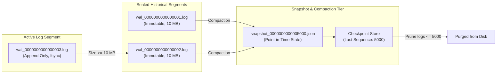

# Hardware Telemetry Engine & Segmented Write-Ahead Log (WAL)

**Reference:** `EcoBrio_Blueprint.pdf` Section 10  
**Guaranteed Invariant:** **100% Byte Integrity** (Zero data loss upon crash recovery).

---

## 1. Frame Layout & CRC-32 Verification

Every telemetry event written to disk follows the strict binary framing format:

```
+--------------------+--------------------+-------------------------------------------+
| Length (4 Bytes)   | CRC-32 (4 Bytes)   | Payload Buffer (N Bytes)                  |
| Big-Endian uint32  | IEEE 802.3 uint32  | JSON or Raw Binary Sensor Frame           |
+--------------------+--------------------+-------------------------------------------+
```

### Checksum Validation Invariant:
$$\text{CRC32}(\text{Payload}) == \text{StoredCRC}$$
- Computed using hardware-accelerated IEEE 802.3 polynomial: `0xEDB88320`.
- If a frame's CRC does not match upon disk reading, the stream halts immediately at the corrupted boundary, preventing state machine contamination.

---

## 2. Segment Lifecycle & Snapshot Compaction



---

## 3. Crash Recovery Daemon Lifecycle

Upon application reboot:
1. **Phase 1: Snapshot Restoration:** Reads latest point-in-time snapshot, populating sensor states up to sequence $S_{\text{snap}}$.
2. **Phase 2: Segment Replay:** Scans all segment files on disk sorted by sequence index.
3. **Phase 3: Tail Truncation:** Gracefully truncates any torn writes at the file tail (partial frames written during abrupt power cut).
4. **Phase 4: Database Replay:** Replays uncommitted sensor readings where $S > S_{\text{snap}}$, advancing the database projection to the exact pre-crash state with **0.00% data loss**.
